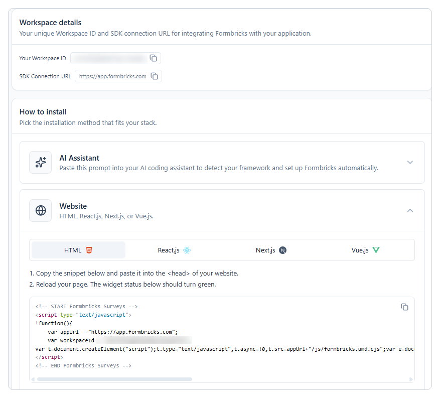
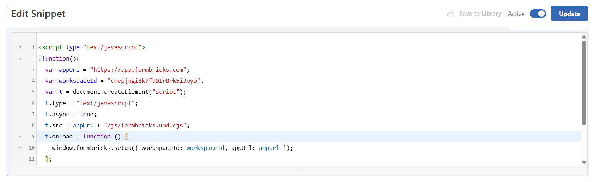
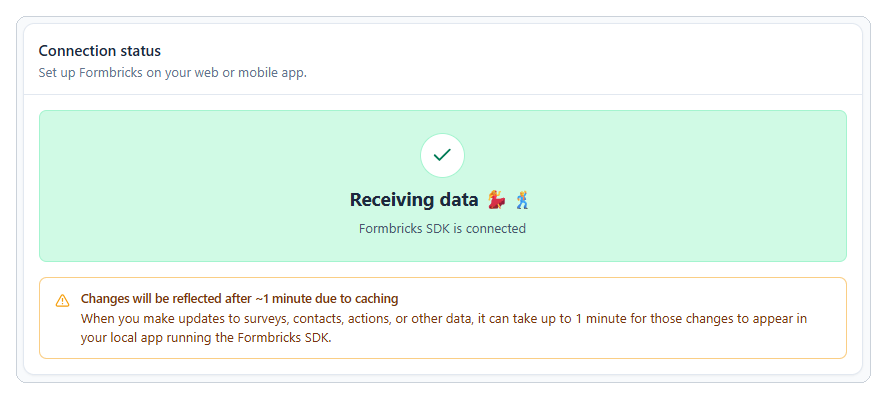
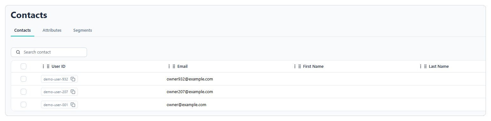

# Install the widget and identify logged-in users

This guide shows you how to load the Formbricks widget on every page of your app and identify logged-in users.

Your product team wants to ask users for feedback at key moments, such as right after they send their first invoice. The team builds and manages these surveys in Formbricks. Your part is a one-time setup that gives Formbricks two things it can't get on its own:

1. **Access to your app.** A short code snippet loads the Formbricks SDK on every page. The SDK watches for the moments the team chooses and shows the right survey inside your app. Without the SDK, the team can send surveys only as links, after the moment has passed.
2. **The identity of each user.** By default, every visitor is anonymous. When you identify logged-in users, the team can do the following:
    - Target the right people, such as new users on a trial plan.
    - Avoid surveying the same person twice, even across devices and browsers.
    - See who gave each answer, so they can follow up with a customer who leaves a low rating.

After you complete this setup, the team can create, target, and change surveys without asking you for more code.

!!! note

    Identifying users requires a Formbricks Pro plan or higher. On the free Hobby plan, you can install the widget and show surveys to anonymous visitors, but you can't identify users or target them by attributes. For current plan details, see [Formbricks pricing](https://formbricks.com/pricing).

## Before you begin

Make sure you have the following:

- A Formbricks account with a workspace for your app.
- Access to **Settings** > **Web & Mobile SDK** in that workspace.
- Access to your site's code or, for WordPress, administrator access so you can install plugins.

## Get your Workspace ID

The snippet connects your site to one Formbricks workspace by its Workspace ID.

1. In Formbricks, go to **Settings** > **Web & Mobile SDK**.
2. Under **Workspace details**, copy **Your Workspace ID**.



## Add the snippet to your site

Copy this snippet, and replace `YOUR_WORKSPACE_ID` with your Workspace ID:

```html
<!-- START Formbricks Surveys -->
<script type="text/javascript">
!function(){
  var appUrl = "https://app.formbricks.com";
  var workspaceId = "YOUR_WORKSPACE_ID";
  var t = document.createElement("script");
  t.type = "text/javascript";
  t.async = true;
  t.src = appUrl + "/js/formbricks.umd.cjs";
  t.onload = function () {
    window.formbricks.setup({ workspaceId: workspaceId, appUrl: appUrl });
  };
  var e = document.getElementsByTagName("script")[0];
  e.parentNode.insertBefore(t, e);
}();
</script>
<!-- END Formbricks Surveys -->
```

Paste it into the `<head>` of every page, or once in your site's layout template so it loads everywhere. If you self-host Formbricks, also replace `appUrl` with the **SDK Connection URL** shown on the **Web & Mobile SDK** page.

!!! warning "Why this snippet differs from the one in Formbricks"

    The snippet under **How to install** on the **Web & Mobile SDK** page waits a fixed half-second before it starts the SDK. If the SDK script takes longer to download, setup fails: the widget looks loaded, but no survey ever appears. This version starts the SDK only after the script finishes loading, so it works on slow connections too.

## Add the snippet to WordPress with WPCode

If your site runs on WordPress, use the free WPCode plugin. It adds code to every page of your site without editing your theme files.

!!! note

    Formbricks also lists an official WordPress plugin on the same page. It was last updated in 2024 and hasn't been tested with recent WordPress releases, so this guide uses WPCode. If you choose the official plugin, confirm that it supports your WordPress version first.

1. In WordPress, go to **Plugins** > **Add New Plugin**, search for **WPCode**, and then click **Install Now** and **Activate**.
2. Go to **Code Snippets** > **+ Add Snippet**, and then select **Add Your Custom Code (New Snippet)**.
3. Enter a title, such as **Formbricks – site header**.
4. For **Code Type**, select **HTML Snippet**, and then paste the snippet into **Code Preview**.
5. Under **Insertion**, set **Insert Method** to **Auto Insert** and **Location** to **Site Wide Header**.
6. Switch the toggle to **Active**, and then click **Save Snippet**.
7. Reload the page and confirm that the toggle still shows **Active**.



!!! tip

    If your site uses a caching plugin, clear the cache so visitors receive the updated pages.

## Verify the install

1. Open any page of your website in a browser, so it loads the Formbricks SDK.
2. In Formbricks, go to **Settings** > **Web & Mobile SDK**, and then click **Re-check** under **Connection status**.

    The status turns green and shows **Receiving data**, which confirms that your website is connected.

    

3. Optional: In your browser's developer console, enter `window.formbricks`. If the SDK loaded, the console returns an object.

!!! tip

    For detailed logs, add `?formbricksDebug=true` to the page URL.

## Identify logged-in users

To show surveys to specific groups of users, such as new users on a trial plan, Formbricks needs to know who each user is. Anonymous visitors can see only surveys with no targeting. After a user logs in, call the identification methods in this section to send Formbricks their user ID and attributes. Formbricks then creates a contact for the user, or updates an existing one.

### Send the user's identity after login

In your app's login handler, call these methods in this order:

```js
// 1. Required, and must come first
formbricks.setUserId(user.id);

// 2. Optional: the user's email
formbricks.setEmail(user.email);

// 3. Optional: attributes your team can use for targeting
formbricks.setAttributes({
  plan: "trial",
  signup_date: "2026-10-01",
});
```

Call `setUserId` first. Formbricks drops any attributes sent before it.

!!! note "Attribute names must be lowercase"

    Formbricks only accepts attribute keys that use lowercase letters, numbers, and underscores, and that start with a letter. A key such as `signupDate` is skipped without stopping your app, so use `signup_date` instead. The only sign of the problem is an error in the browser console.

### Clear the user at logout

In your app's logout handler, call:

```js
formbricks.logout();
```

This prevents the next person who uses the same browser from being linked to the previous user's contact.

### Keep in mind

- Use a user ID that is unique and doesn't change, such as a database ID. Don't use a display name.
- Each email address can belong to only one contact in a workspace.
- Tell your product team which attribute keys you send (for example, `plan` and `signup_date`). They use these to target surveys.

### Test the identification

1. Log in to your app as a test user.
2. In Formbricks, go to **Contacts** and confirm that the test user appears in the list.

!!! note

    The screenshots in this guide use a demo page that has no login. Its **Identify user** button sends the same `setUserId` and `setAttributes` calls that your login code does.



## Report key events with code actions (optional)

If your product team wants a survey to appear after a task that doesn't load a new page, such as sending an invoice from a dialog, they may ask you to report the event from your code. Get the action key from them, such as `invoice_sent`.

Call `formbricks.track()` with that key after the task succeeds:

```js
// After the invoice is sent successfully
formbricks.track("invoice_sent");
```

- The key must match the action in Formbricks exactly, including capitalization.
- Call `track()` after the task succeeds, not when the user clicks the button.
- For logged-in users, call `setUserId()` first, so the event is linked to the user.

To check that the event fires, see [Verify the trigger](04-trigger-a-survey.md#verify-the-trigger).

## Hand off to your product team

After you finish the setup, send your product team the details they need to build and target surveys:

| Item | What to share | Example |
|---|---|---|
| Workspace | The workspace the snippet connects to | LedgerWiz (`cmvpjngi8k7fb01r8rk5i3oyo`) |
| Attribute keys | Each attribute you send, and its possible values | `plan`: trial, starter, pro · `signup_date`: date (YYYY-MM-DD) |
| Code action keys | Each event you report with `track()`, and when it fires | `invoice_sent`: after an invoice is sent successfully |

With these details, the team can create surveys, define segments, and set triggers in Formbricks without further code changes.

## Next steps

Share these guides with your product team:

- [How in-app surveys work](02-how-in-app-surveys-work.md)
- [Build your first in-app survey](03-build-your-first-survey.md)
