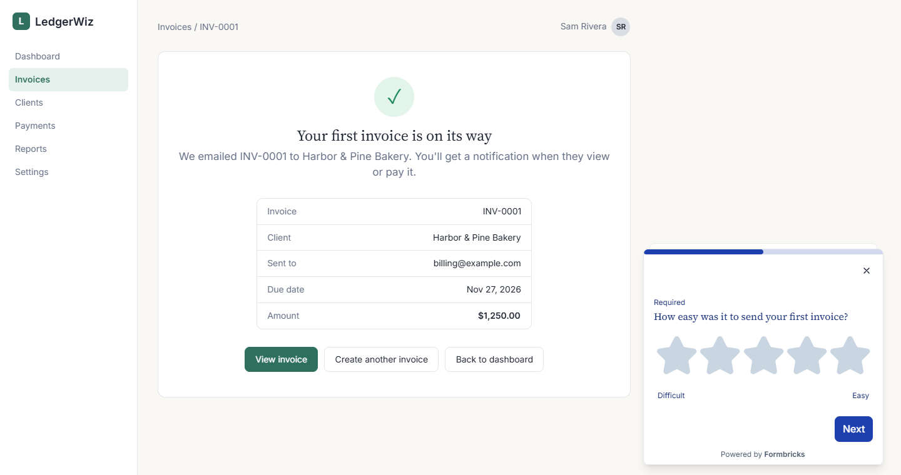
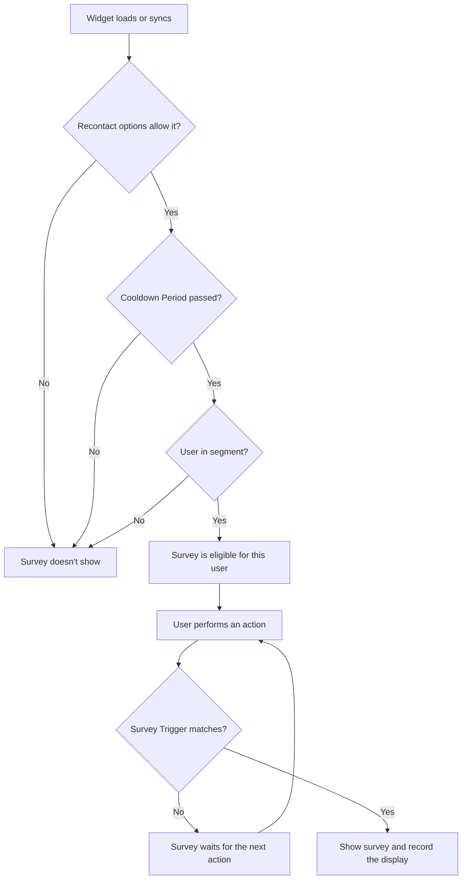

# How in-app surveys work

This article explains the basics of in-app surveys and how they work in Formbricks. It covers the four building blocks of an in-app survey, the checks Formbricks runs before it shows one, the difference between identified and anonymous users, how to test a survey safely, and how long changes take to appear. The examples follow LedgerWiz, an invoicing app that asks new users for feedback after they send their first invoice.

An in-app survey appears inside your product when a user does something you want feedback on, and only if that user passes a short series of checks. A link survey waits for people to open it. An in-app survey waits for the right moment and then appears on its own, while the user is still in context.

*Figure 1: An in-app survey appears in LedgerWiz right after a user sends an invoice.*

In-app surveys are built from four parts:

- **Widget (SDK).** The script your developer adds to your app. It watches for actions and displays a survey when every check passes. To install it, see [Install the widget and identify logged-in users](01-install-the-widget.md).
- **Actions.** Events that can start a survey. You set up no-code actions in Formbricks: **Click**, **Page View**, **Exit Intent**, **50% Scroll**, and **Time on Page**. Your developer sends code actions from the app, for example `formbricks.track("invoice_sent")`.
- **Targeting (segments).** Rules that decide which users are eligible, based on attributes such as plan or signup date. Targeting works only for identified users. Available on Pro and Scale plans.
- **Workspace.** The container that holds your surveys, actions, and attributes. The widget connects to one workspace using its Workspace ID.

Here's how LedgerWiz uses each part:

| Building block | LedgerWiz setup |
|---|---|
| Widget | Installed in the logged-in LedgerWiz app. |
| Action | `invoice_sent`, a code action that fires when a user sends an invoice. |
| Segment | **New users (last 14 days)**: users whose signup date is within the last 14 days. |
| Workspace | One workspace, named **LedgerWiz**. |

LedgerWiz could also use a no-code **Page View** action on the invoice-sent page. It uses one or the other, not both, so the survey doesn't trigger twice for the same invoice.

!!! note "Environments are now workspaces"

    Older Formbricks docs and API references mention *environments* and an *environment ID*. Formbricks now uses workspaces. Where you see an environment ID, use your Workspace ID.

## How Formbricks decides to show a survey

!!! note "Only active surveys appear"

    A survey can appear only when its status is **Active**. Draft, paused, and completed surveys never show, even if every check below passes.

Formbricks checks a survey in two stages: first when the widget loads, then when the user acts.

*Figure 2: Formbricks checks eligibility when the widget loads, then waits for a matching action.*

When the widget loads or syncs, Formbricks runs checks 1–3 to decide which surveys the current user is eligible for. When the user performs an action, it runs checks 4 and 5 on the surveys that passed:

1. **Recontact options.** Formbricks checks whether this user has already seen or answered the survey as often as the survey allows. For example, a survey set to **Show only once** won't appear again for the same user, while **Ask until they submit a response** keeps showing it until they answer.
2. **Cooldown Period.** Formbricks checks whether enough time has passed since this user saw *any* survey from your workspace. This stops one person from getting several surveys in a row. The workspace sets a default (7 days unless you change it). In a survey's **Display & Recontact** settings, you can choose **Ignore Cooldown Period** or **Set custom Cooldown Period** for that survey only.
3. **Segment.** Formbricks checks whether the user matches the survey's targeting. Anonymous visitors only qualify for surveys without targeting filters. Targeting is available on Pro and Scale plans.
4. **Survey Trigger.** Formbricks checks whether the action is one of the survey's triggers. If it isn't, the survey stays eligible and waits for the next action.
5. **Show and record.** The survey appears, and Formbricks records the display. The next recontact and cooldown checks use that record.

**Example:** Sam signed up for LedgerWiz 6 days ago. When he opens the app, Formbricks runs the first three checks:

- Sam hasn't seen the **First invoice feedback** survey, which is set to **Show only once**.
- Sam hasn't seen any other LedgerWiz survey recently, so the Cooldown Period has passed.
- Sam signed up within the last 14 days, so he's in **New users (last 14 days)**.

The survey is now eligible for Sam. When he sends his first invoice, `invoice_sent` fires and matches the survey's trigger, and the survey appears. The next time Sam opens the app, the recontact check rules the survey out before he does anything.

If a survey isn't appearing, work through these checks in order. Most problems come from one of them. To see the checks at work, add `?formbricksDebug=true` to your page URL and open the browser console. When the page loads, Formbricks logs how many surveys the current user is eligible for. For step-by-step help, see *Troubleshoot a survey that isn't appearing* (in progress).

*Figure 3: Where each check is configured for a survey. Targeting requires a paid plan.*

!!! info "Timing to expect"

    Formbricks says changes reach the widget in about a minute, but browsers that already loaded the widget can keep the previous version for longer. To see a change right away while testing, reload with `?formbricksDebug=true`, which refetches survey settings on every load.

    Segment membership is recalculated when the widget syncs, not the moment an attribute changes. A user who just qualified might not see the survey until a later page load.

## When to use anonymous or identified users

The widget treats every visitor as anonymous until your app identifies them with a user ID. Which you need depends on where the survey runs.

**In your logged-in app, identify users** (Available on Pro and Scale plans). Once a user is identified, you can target surveys by attributes such as plan or signup date. LedgerWiz identifies each user after login, which is how it limits the invoice survey to new users. Your developer sets this up when installing the widget. See [Install the widget and identify logged-in users](01-install-the-widget.md#identify-logged-in-users).

**On your public website, anonymous is enough.** Visitors on a marketing site haven't logged in, so you can't target them by attributes. You can still choose the action that triggers a survey and limit how often it appears. For example, LedgerWiz could show an **Exit Intent** survey on its pricing page asking visitors what stopped them from signing up.

## Comparison of anonymous and identified users

| | Anonymous | Identified |
|---|---|---|
| Triggered by actions | Yes | Yes |
| Recontact options and Cooldown Period | Yes | Yes |
| Targeting by segments | No | Yes |
| Plan required | All plans | Pro and Scale |
| LedgerWiz example | Exit Intent survey on the pricing page | First invoice feedback in the app |

*Table 1: What each user type supports.*

## Test a survey without reaching real users

Formbricks no longer has separate development and production environments. Your live widget loads every **Active** survey in its workspace, so you test by controlling who can trigger the survey.

**On any plan, use a test-only action.** Create a code action such as `invoice_sent_test`, fire it only from a test page or staging build, and set it as the survey's trigger. Real users never fire that action, so they never see the survey. When you're ready to launch, replace the test trigger with the real action, `invoice_sent`.

**On Pro and Scale plans, you can also:**

- **Target a test segment.** Create a segment only your team matches, such as **LedgerWiz team** (email ends in your company domain), test the survey, then switch the targeting to the real segment.
- **Use a separate workspace.** Pro includes 3 workspaces and Scale includes 5. Point a test copy of your app at the test workspace's ID so test responses never mix with real ones.

After testing, remove test responses from the survey's **Responses** tab: open a response and select **Delete response**.

If you followed older guides that mention a test environment, use one of these methods instead.

## Related resources

To dive deeper or start building, see the following:

**How-to guides**

1. [Install the widget and identify logged-in users](01-install-the-widget.md)
2. [Build your first in-app survey](03-build-your-first-survey.md)

**Troubleshooting**

1. *Troubleshoot a survey that isn't appearing* (in progress)

---

← Previous: [Install the widget and identify logged-in users](01-install-the-widget.md) | Next: [Build your first in-app survey](03-build-your-first-survey.md) →
