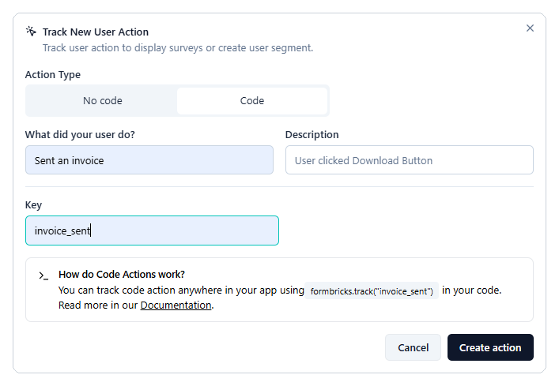
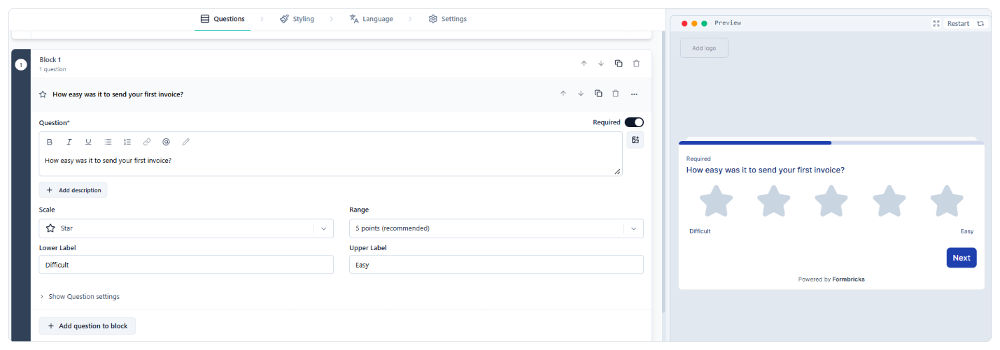
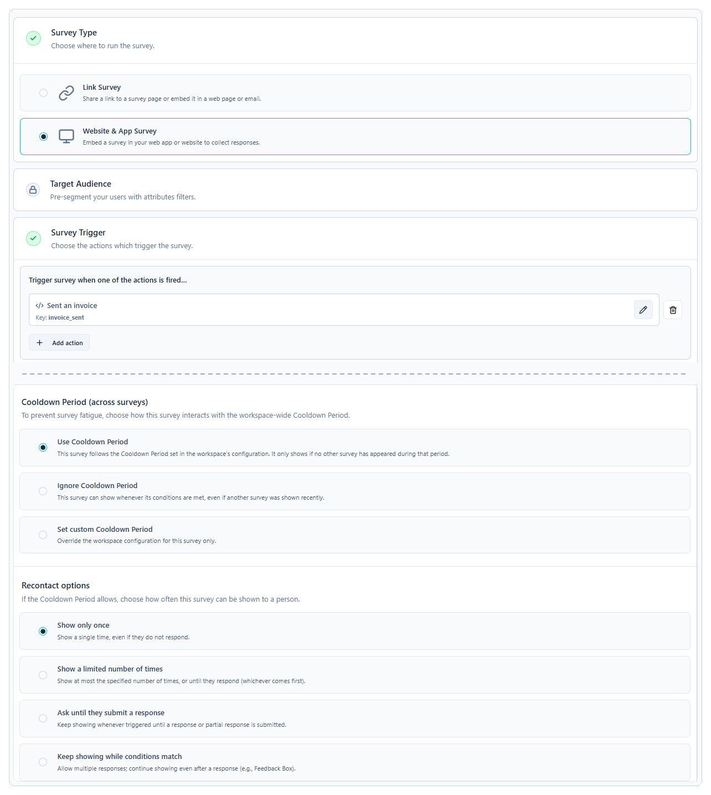
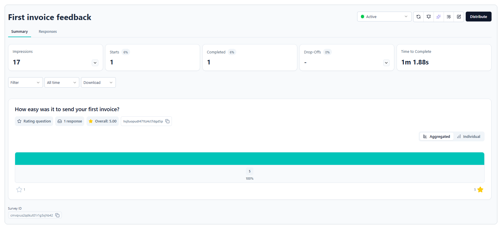

# Build your first in-app survey

This guide shows you how to build an in-app survey in Formbricks from start to finish. You'll create the action that starts the survey, write the question, choose when and how often the survey appears, activate it, and test it before real users see it.

The examples follow LedgerWiz, an invoicing app that asks new users how easy it was to send their first invoice. By the end, you'll have a one-question survey that appears right after a user sends an invoice. To learn how Formbricks decides when to show a survey, see [How in-app surveys work](02-how-in-app-surveys-work.md).

## Before you begin

Make sure you have:

- A Formbricks Cloud account and a workspace for your app. LedgerWiz uses one workspace named **LedgerWiz**.
- The Formbricks widget installed in your app. See [Install the widget and identify logged-in users](01-install-the-widget.md).
- A developer who can add one line of code where the user's action happens, such as after an invoice is sent.
- A test page or staging build of your app where you can trigger the survey yourself.

To show the survey only to some users, such as new sign-ups, you also need:

- A **Pro** or **Scale** plan. Targeting and user identification aren't available on the free **Hobby** plan.
- Identified users with the attribute you want to target. LedgerWiz sends each user's signup date as `signup_date`.

!!! note "Attribute names must be lowercase"

    Formbricks only accepts attribute keys that use lowercase letters, numbers, and underscores, and that start with a letter. A key such as `signupDate` is skipped without stopping your app, so use `signup_date` instead. The only sign of the problem is an error in the browser console.

## Step 1: Create the action that starts the survey

An action records that something happened in your app. LedgerWiz uses a code action, so the survey appears only after an invoice is actually sent.

1. In Formbricks, go to **Settings** > **User Actions**.
2. Click **Add action**.
3. In the **Track New User Action** dialog, under **Action Type**, select **Code**.
4. In **What did your user do?**, enter a name that describes the action, such as **Sent an invoice**.
5. In **Key**, enter a key, such as `invoice_sent`. Your developer uses this key in the app, so it must match exactly.
6. Click **Create action**.
7. Ask your developer to add this call right after the action succeeds in your app:

    ```js
    // After the invoice is sent successfully
    formbricks.track("invoice_sent");
    ```



*Figure 1: Creating a code action for LedgerWiz.*

If you'd rather not write code, you can use a no-code action instead, such as a **Page View** on your confirmation page. Use one or the other, not both, or the survey can trigger twice for the same event. For all three action types, see [Trigger a survey after a specific user action](04-trigger-a-survey.md).

## Step 2: Create the survey

1. Go to **Surveys** and click **New Survey**.
2. Choose to start from scratch. Templates such as **NPS Survey** and **CSAT** are also available if one fits your goal.
3. At the top of the editor, rename the survey to something your team recognizes, such as **First invoice feedback**.

## Step 3: Write the question

Short surveys get more answers. LedgerWiz asks a single rating question.

1. On the **Questions** tab, open the menu on the first question and select **Change question type** > **Rating**. The list scrolls, so scroll down if you don't see **Rating**.
2. Enter the question: **How easy was it to send your first invoice?**
3. Set **Scale** to **Star** and **Range** to **5 points (recommended)**.
4. Set **Lower Label** to **Difficult** and **Upper Label** to **Easy**.

Formbricks adds a **Thank you!** screen after the last question. Keep it so users know their answer was sent.



*Figure 2: The LedgerWiz rating question.*

## Step 4: Choose where and when the survey appears

Select **Continue to Settings**, or select the **Settings** tab.

1. In **Survey Type**, select **Website & App Survey**.
2. In **Survey Trigger**, click **Add action** and select **Sent an invoice**. **Survey Trigger** only appears for website and app surveys.
3. In **Display & Recontact**, under **Recontact options**, select **Show only once**. Each user sees the survey at most one time.
4. Under **Cooldown Period (across surveys)**, keep **Use Cooldown Period**. This stops one person from getting several surveys in a row.



*Figure 3: The trigger and recontact settings for the LedgerWiz survey. Target Audience is locked on the Hobby plan.*

## Step 5: (Optional) Show the survey only to new users

!!! note "Available on Pro and Scale plans"

    On the **Hobby** plan, the **Target Audience** card is locked, and the survey shows to everyone who triggers the action. Skip this step and continue to step 6.

LedgerWiz only wants feedback from people who signed up in the last 14 days.

1. In **Target Audience**, add a filter on the `signup_date` attribute.
2. Set the filter to match dates within the last 14 days.
3. Save the filter as a segment named **New users (last 14 days)** so you can reuse it.

## Step 6: Activate the survey

1. On the **Settings** tab, click **Activate**. The button appears only on the **Settings** tab. On the **Questions** tab, the same position shows **Continue to Settings**.
2. If Formbricks takes you back to a question, fix the highlighted field and click **Activate** again.
3. Go to **Surveys** and check that the survey's status is **Active**.

Only **Active** surveys reach the widget. A survey saved as a draft never appears, even if everything else is set up correctly.

## Step 7: Test the survey

Test on your test page or staging build before you rely on real users.

1. Open your test page with `?formbricksDebug=true` at the end of the URL, and open the browser console.
2. If the survey uses targeting, sign in as a test user who matches it. For LedgerWiz, that's a user who signed up in the last 14 days. Then reload the page.
3. In the console, find the line that reports how many surveys could be shown. It should say **1**.
4. Trigger the action, for example by sending a test invoice. The survey appears.
5. Answer the survey.

!!! tip "Testing again"

    With **Show only once**, the same test user never sees the survey again, even in a private window. Formbricks records the display against the user, not the browser. Use a new test user for each run.

If the console reports **0** surveys, or nothing appears, see *Troubleshoot a survey that isn't appearing* (in progress). To test without any chance of reaching real users, see [Test a survey without reaching real users](02-how-in-app-surveys-work.md#test-a-survey-without-reaching-real-users).

## Step 8: Check the results

1. Go to **Surveys** and open **First invoice feedback**.
2. The **Summary** tab shows the overall results. The **Responses** tab lists each response.
3. To remove a test response, open it on the **Responses** tab and click **Delete response**.



*Figure 4: Results for the LedgerWiz survey.*

## Results

Your survey is live. When a user sends an invoice, Formbricks checks whether the survey is eligible for them and, if so, shows the rating question. Each user sees it at most once, and the workspace Cooldown Period keeps users from getting several surveys in a row.

Changes you make later can take a minute or more to reach users whose browsers already loaded the widget.

## See also

**Concepts**

1. [How in-app surveys work](02-how-in-app-surveys-work.md)

**How-to guides**

1. [Install the widget and identify logged-in users](01-install-the-widget.md)
2. [Trigger a survey after a specific user action](04-trigger-a-survey.md)

**Troubleshooting**

1. *Troubleshoot a survey that isn't appearing* (in progress)

---

← Previous: [How in-app surveys work](02-how-in-app-surveys-work.md) | Next: [Trigger a survey after a specific user action](04-trigger-a-survey.md) →
