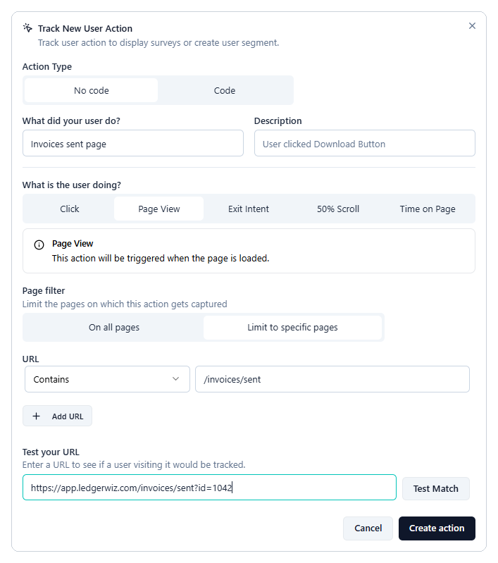
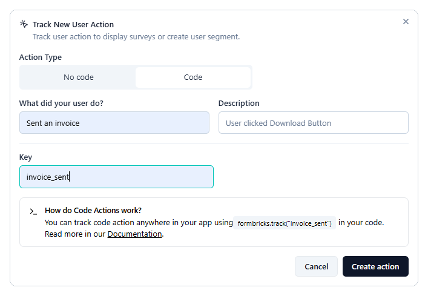

# Trigger a survey after a specific user action

This guide shows you how to show a survey right after a user completes a key task, such as sending their first invoice. You create an action that records when the task happens, then attach it to your survey as the trigger.

The examples follow LedgerWiz, an invoicing app that asks new users how easy it was to send their first invoice.

## Before you begin

- Install the Formbricks widget in your app. See [Install the widget and identify logged-in users](01-install-the-widget.md).
- Create a survey in draft. See [Build your first in-app survey](03-build-your-first-survey.md).

Actions are available on all plans, including **Hobby**.

## Choose an action type

Pick the action type that matches how the task ends in your app:

| Action type | Use it when | Needs a developer? |
|---|---|---|
| **Page View** (no code) | The task ends on its own page, such as `/invoices/sent`. | No |
| **Click** (no code) | The task ends with a button click you can identify by its CSS selector or text. | No |
| Code action | The task has no unique page or button, or you need the trigger to survive redesigns. | Yes, one line of code |

Formbricks also offers **Exit Intent**, **50% Scroll**, and **Time on Page** actions. They suit browsing behavior, such as a visitor leaving your pricing page, more than finishing a task.

LedgerWiz uses a code action. Its confirmation page can also open from other places in the app, so the page URL alone doesn't prove that an invoice was just sent.

!!! warning "Use one action per task"

    Don't create a page view and a code action for the same task and attach both. Each one can trigger the survey, so one invoice can count twice.

## Create a Page View action

1. In Formbricks, go to **Settings** > **User Actions**.
2. Click **Add action**.
3. In the **Track New User Action** dialog, under **Action Type**, select **No code**.
4. In **What did your user do?**, enter a name, such as **Invoices sent page**.
5. Under **What is the user doing?**, select **Page View**.
6. Under **Page filter**, select **Limit to specific pages**. Under **URL**, choose **Contains** and enter `/invoices/sent`. To match more pages, click **Add URL**.
7. Under **Test your URL**, paste a real URL from your app, such as `https://app.ledgerwiz.com/invoices/sent?id=1042`, and click **Test Match** to check that the rule matches it.
8. Click **Create action**.

Use **Test Match** to check your rule against a real URL from your app, including any query string.



*Figure 1: A Page View action limited to the invoice-sent page.*

## Create a Click action

1. In **Settings** > **User Actions**, click **Add action**.
2. In the **Track New User Action** dialog, under **Action Type**, select **No code**.
3. In **What did your user do?**, enter a name, such as **Send invoice button**.
4. Under **What is the user doing?**, select **Click**.
5. Turn on **CSS Selector** and enter the button's selector, such as `#send-invoice`. Or turn on **Inner Text** and enter the button's label, such as `Send invoice`.
6. (Optional) Under **Page filter**, select **Limit to specific pages** to count clicks on one page only.
7. Click **Create action**.

!!! warning "Redesigns can break Click actions"

    If someone renames the button or changes its CSS class, the action stops matching, and Formbricks doesn't warn you. Recheck Click actions after each release that touches that page.

## Create a code action

1. In **Settings** > **User Actions**, click **Add action**.
2. In the **Track New User Action** dialog, under **Action Type**, select **Code**.
3. In **What did your user do?**, enter a name that describes the action, such as **Sent an invoice**.
4. In **Key**, enter a key, such as `invoice_sent`. Your developer uses this key in the app, so it must match exactly.
5. Click **Create action**.
6. Ask your developer to add this call right after the task succeeds in your app. The key must match exactly.

    ```js
    // After the invoice is sent successfully
    formbricks.track("invoice_sent");
    ```



*Figure 2: A code action with the key invoice_sent.*

## Attach the action to your survey

1. Open your survey and select the **Settings** tab.
2. In **Survey Trigger**, click **Add action** and select the action you created.
3. To start the survey from more than one place, add more actions. Any one of them can trigger the survey.
4. Click **Activate**, or **Save** if the survey is already active.

## Verify the trigger

1. Open your app with `?formbricksDebug=true` at the end of the URL, and open the browser console.
2. Complete the task. In LedgerWiz, that's sending an invoice.
3. In the console, look for a line like this:

    ```
    Formbricks: Action "invoice_sent" tracked
    ```

If the next line is **No active surveys to display**, the trigger is working, and one of the other checks is stopping the survey, such as targeting or recontact options. See [How in-app surveys work](02-how-in-app-surveys-work.md), or *Troubleshoot a survey that isn't appearing* (in progress).

If no action line appears, check that the code action key matches exactly, or that the page view rule matches the real URL.

## See also

1. [How in-app surveys work](02-how-in-app-surveys-work.md)
2. *Target only new users and prevent repeat surveys* (in progress)
3. *Troubleshoot a survey that isn't appearing* (in progress)

---

← Previous: [Build your first in-app survey](03-build-your-first-survey.md)
